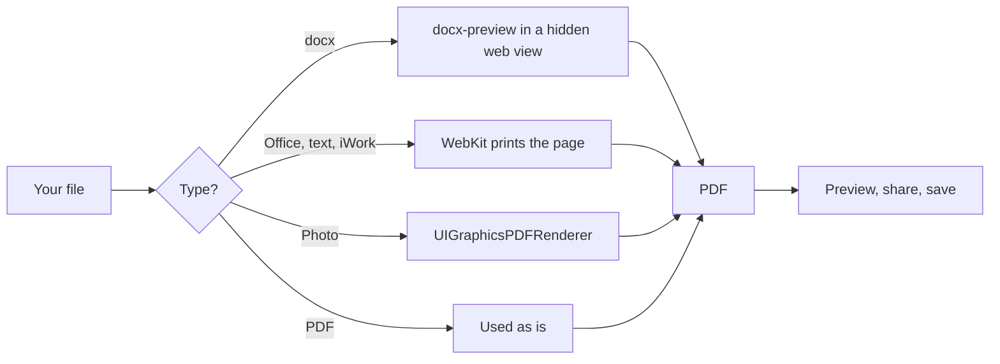

<div align="center">

<h1>📄 Ainal PDF</h1>

<p><b>Turn any document or photo into a PDF. Right on your iPhone.</b><br>
No account. No upload. No waiting for a server.</p>

<p>
  
  
  
  
  
</p>

<br>


&nbsp;&nbsp;

&nbsp;&nbsp;


</div>

<br>

## ✨ Features

| | |
| --- | --- |
| 📂 **Many formats** | Word, PowerPoint, Excel, Pages, Keynote, Numbers, text, images and more. |
| 🖼️ **Photos to PDF** | Pick one photo or many. Each one gets its own page. |
| 📐 **Page size** | Choose A4, Letter or Original size before you convert. |
| 📲 **Open in...** | Send a file from another app (like Air Printer) straight into Ainal PDF. |
| 👀 **Preview and share** | Check the PDF, then share it or save it to Files. |
| 🕘 **Recent list** | Your last PDFs are saved in the app. |
| 🔒 **Private** | Everything runs on the device. Nothing leaves your phone. |

## 🚀 How to use

1. **Pick a page size** at the top: A4, Letter or Original size.
2. Tap **Choose a file** or **Choose photos**.
3. Wait a moment while it converts.
4. Preview the PDF, then tap **Share or save PDF**.

> 💡 You can also start from another app. Open the file there, tap **Share**, then **Open in...** or **Copy to...**, and pick **Ainal PDF**.

## 📐 Page size

| Option | What it does |
| :--- | :--- |
| **A4** | Fits content on A4 pages. This is the default. |
| **Letter** | Fits content on US Letter pages. |
| **Original size** | Photos keep their own size, with no margins. |

> Word (`.docx`) files keep the page size set in the file. PDFs are not changed. Other documents use A4 when you pick Original size.

## 📁 Supported files

| Type | Extensions |
| :--- | :--- |
| 📝 Word | `docx` `doc` `dot` |
| 📊 PowerPoint | `pptx` `ppt` `ppsx` `pps` |
| 📈 Excel and tables | `xlsx` `xls` `csv` `tsv` |
| 🍎 Apple iWork | `pages` `numbers` `key` |
| 🔤 Text and web | `txt` `rtf` `md` `log` `json` `xml` `yaml` `html` `svg` |
| 🖼️ Images | `jpg` `png` `heic` `tiff` `gif` `bmp` `webp` `ico` `dng` |
| 📕 PDF | opened as is |

## ⚙️ How it works



- **Word files:** a bundled JavaScript renderer draws each page. One Word page becomes one PDF page.
- **Other documents:** a hidden WebKit view shows the file and prints it to PDF. Slides, sheets and text each get their own layout.
- **Photos:** placed on pages with `UIGraphicsPDFRenderer`.

## 🗂️ Project layout

<details>
<summary>Click to open</summary>

```
AinalPDF/
├── AinalPDFApp.swift            App entry
├── ContentView.swift            Home screen and file picker
├── ConverterViewModel.swift     Input, saving and history
├── Converter/
│   ├── DocumentConverter.swift        One entry point for all types
│   ├── DocxPDFConverter.swift         Word files
│   ├── WebDocumentPDFExporter.swift   Office, text and iWork files
│   ├── ImagePDFBuilder.swift          Photos
│   └── Support.swift                  Page sizes
├── DocxRender/                  Bundled JS and HTML for Word
└── Views/                       PDF preview and result screen
Config/
└── DocumentTypes-Info.plist     Lets other apps send files here
```

</details>

## 🛠️ Build

1. Open `AinalPDF.xcodeproj` in Xcode.
2. Pick an iPhone or a simulator.
3. Press **Run**.

Needs iOS 16 or later.

## ⚠️ Limits

- Very complex Word or PowerPoint layouts may look a bit different from the original.
- Non-Word documents are converted by the system web view, so results can change between iOS versions.

## 📜 License

Free for everyone. Use it, change it, share it, even in your own apps. This project uses the [MIT License](LICENSE).

<div align="center">
<sub>Made with SwiftUI</sub>
</div>
