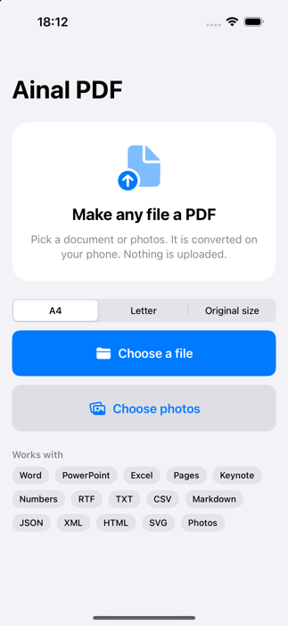
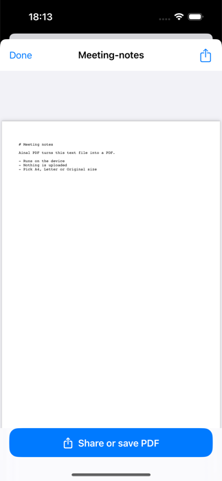
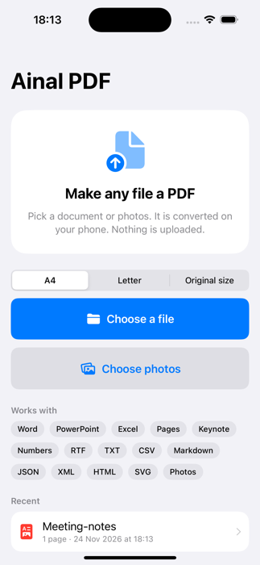

# Ainal PDF

An iPhone app that turns documents and photos into PDF files. It works fully on the device. Nothing is uploaded.

<p align="center">
  
  &nbsp;
  
  &nbsp;
  
</p>

## Features

- Convert Word, PowerPoint, Excel, Pages, Keynote, Numbers, text and more to PDF.
- Turn one or many photos into a PDF.
- Pick the page size before converting: A4, Letter or Original size.
- Receive files from other apps (for example Air Printer) with **Share > Open in...** or **Copy to...**.
- Preview the result, then share or save it.
- Keeps a list of recent PDFs.
- No account, no network, no upload.

## How to use

1. Pick a page size at the top.
2. Tap **Choose a file** or **Choose photos**.
3. Wait a moment while the file is converted.
4. Preview the PDF. Tap **Share or save PDF** to send it or save it to Files.

Old results stay under **Recent**. Tap one to open it again.

## Page size

| Option | What it does |
| --- | --- |
| A4 | Fits content on A4 pages. This is the default. |
| Letter | Fits content on US Letter pages. |
| Original size | Photos keep their own size, with no margins. |

Word (.docx) files keep the page size set in the file. PDFs are not changed. Other documents use A4 when "Original size" is picked.

## Supported files

| Type | Extensions |
| --- | --- |
| Word | docx, doc, dot |
| PowerPoint | pptx, ppt, ppsx, pps |
| Excel and tables | xlsx, xls, csv, tsv |
| Apple iWork | pages, numbers, key |
| Text | txt, rtf, md, log, json, xml, yaml, html, svg |
| Images | jpg, png, heic, tiff, gif, bmp, webp, ico, dng |
| PDF | opened as is |

## How it works

- **.docx** is drawn by a bundled JavaScript renderer (docx-preview) in a hidden web view. Each Word page becomes one PDF page.
- **Other documents** are shown in a hidden WebKit view and printed to PDF. Slides, spreadsheets and text each get their own page layout.
- **Photos** are placed on pages with `UIGraphicsPDFRenderer`.

## Project layout

```
AinalPDF/
  AinalPDFApp.swift         App entry
  ContentView.swift         Home screen and file picker
  ConverterViewModel.swift  Input, saving and history
  Converter/                Conversion code
    DocumentConverter.swift     One entry point for all file types
    DocxPDFConverter.swift      Word files
    WebDocumentPDFExporter.swift  Office, text and iWork files
    ImagePDFBuilder.swift       Photos
    Support.swift               Page sizes
  DocxRender/               Bundled JS and HTML for Word
  Views/                    PDF preview and result screen
Config/
  DocumentTypes-Info.plist  Lets other apps send files to this app
```

## Build

1. Open `AinalPDF.xcodeproj` in Xcode.
2. Pick an iPhone or a simulator.
3. Press Run.

It needs iOS 16 or later.

## Limits

- Very complex Word or PowerPoint layouts may look a bit different from the original.
- Files are converted by the system web view, so results depend on the iOS version.
